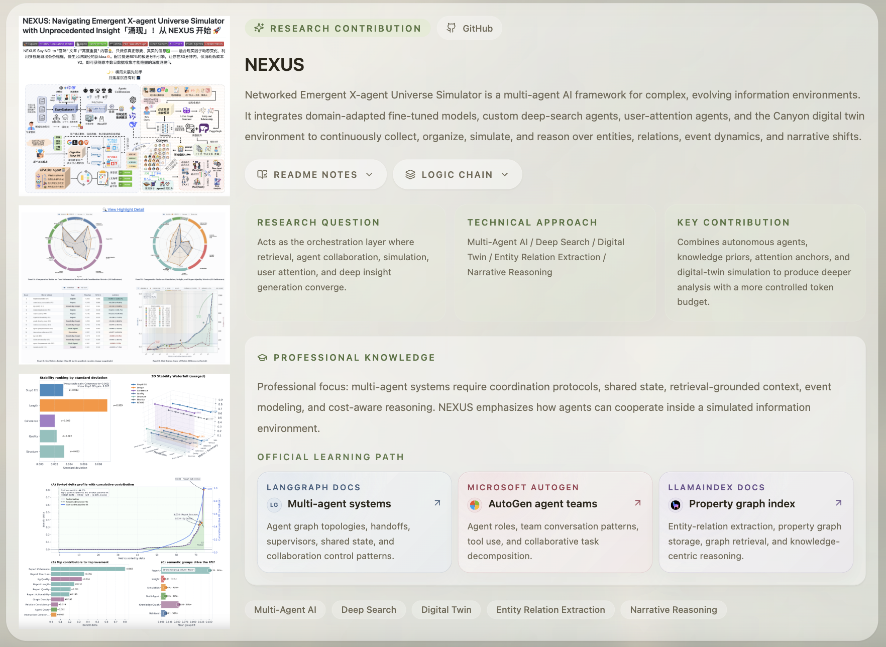
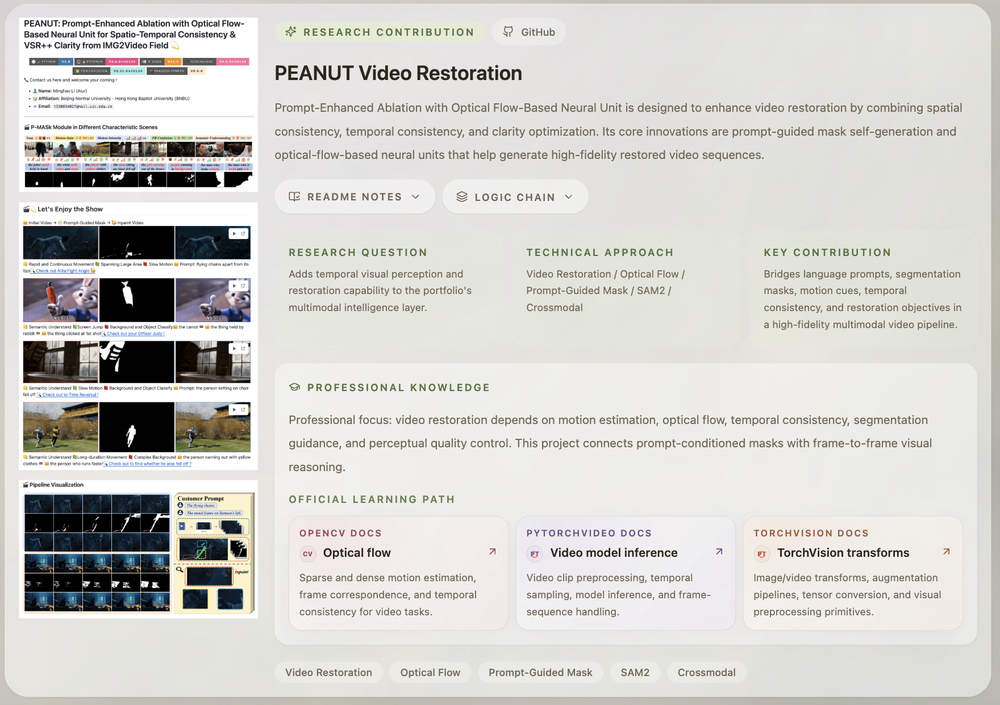
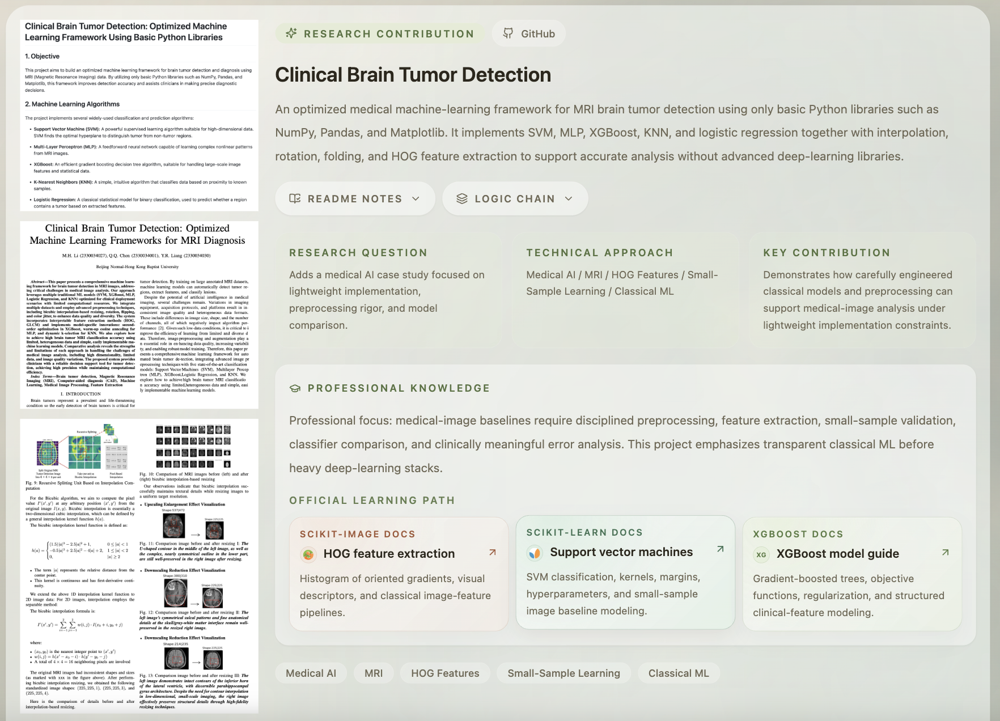

# 👋 Hi, This is Aiur Suleynan

  
  
  

<!-- - Project: [Repositories](https://github.com/SuleynanAuir?tab=repositories) -->
- Email 1 🇨🇳 ZhongGuanCun Artificial Intelligence Institution (中关村人工智能研究院): [l-lmh@zgci.ac.cn](l-lmh@zgci.ac.cn)
- Email 2 🇬🇧 VIOOH-DOOH (户外广告推荐SSP): [li.minghao@viooh.com](li.minghao@viooh.com)
- Email 3 👨‍💻 Personal-Usage: [suleynanaiur@gmail.com](suleynanaiur@gmail.com)

  

  <b>🧑‍💻 AI Engineering • Native Agentic / Computer Vision / NLP Application / Multimodal Understanding / Deep Search </b> 
  🧪 Building grounded, explainable, and product-ready AI systems together. Welcome to Star abd Folk 👏

## 🎉 GitHub Project：Wellcome to Fork and Star... Let's build 🤗

   
  

   
  

   
  

## 🏅 Activities

- **Beijing Zhongguancun Artificial Intelligence Research Institute (Zhongguancun Academic Institute) | Specialized Agent Algorithm Research for ASC | 2026** 
  Conducted specialized Agent algorithm research for ASC, focusing on temporal model simulation and data-efficient few-shot learning for intelligent analysis and decision-making in vertical domains.

- **VIOOH (UK) | Agentic Transformation of Advertising Search & Recommendation Algorithms / Automation Tooling | 2026** 
  Advanced the Agentic transformation of advertising search and recommendation workflows and contributed to automation tools that improve algorithm development, validation, and delivery efficiency.
  
- **NEXUS Community | Initiator & Maintainer | 2025** 
  Launched and maintained the NEXUS community, developed a social-intelligence and public-opinion analysis engine, and extended its Agent, deep-search, and information-simulation capabilities to additional practical domains.

- **DataFun Conference 2025 (Beijing + Shenzhen) | Attendee | Jul & Nov 2025**  
  Participated in DACon by DataFunTalk with a structured focus on Data + AI, large models, data intelligence, and industrial deployment. Followed key topics including LLM applications, search/recommendation systems, NLP, AI Agents, ad algorithms, and data architecture, with practical exposure to RAG, ChatBI, and Data Agent solutions.

- **World Artificial Intelligence Conference (WAIC) | Attendee | 2024 & 2025** 
  Followed WAIC across two years, focusing on multimodal AI, AI Agents, AI-native architectures, and their industrial applications and engineering practices.

- **NVIDIA Technology Conference AI Summit (Taiwan) | Attendee | Jun 2024**  
  Joined NVIDIA GTC-related AI technical sessions and exchanges, focusing on real-world AI applications in medical imaging, 3D reconstruction, and digital twins, while tracking VLM, GenAI, Robotics, and Physical AI trends.

- **Wanxi Xiaobing (Zhongshan) Technology Co., Ltd. | Zhuhai Project Manager | 2024**  
  Led regional promotion and optimization of Xiaobing digital-human solutions in Zhuhai, with hands-on experience in AI product adoption. Worked directly with clients to propose customized C2C solutions and improve product-fit satisfaction.

---

## 🛠️ Technical Strengths

- **Modeling**: ML/DL pipelines, transformer-style methods, multimodal fusion
- **Agent Engineering**: planning, reflection, retrieval augmentation, evaluation loops
- **CV + NLP Integration**: OCR, classification, video processing, language reasoning
- **Implementation**: Python, PyTorch ecosystem, experiment-driven iteration

---

## 🤝 Connect

- GitHub: https://github.com/SuleynanAuir
- Email Welcome to Connect 😊: 
    - *Daily* suleynanaiur@gmail.com
    - *Research & Academic* t330034027@mail.uic.edu.cn
    - *Domestic* 2925795986@qq.com
- LinkedIn: https://www.linkedin.com/in/aiur-suleynan-1a58872b9/

---

> Building AI systems that can search deeply, reason clearly, and deliver reliably.
